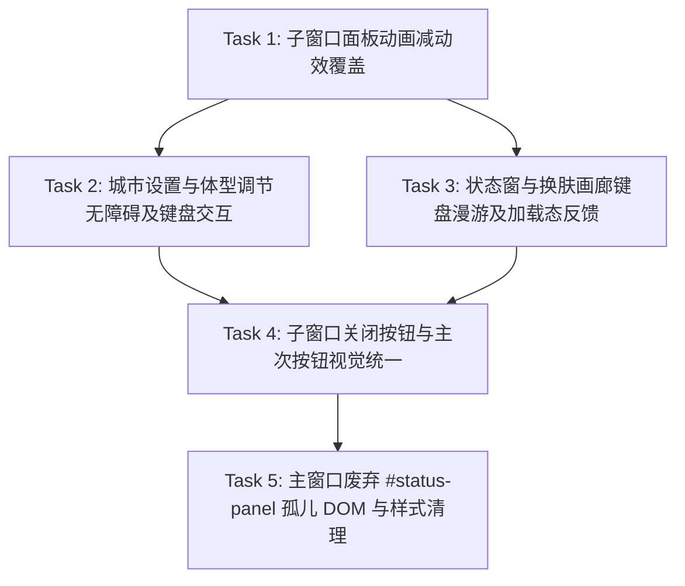

# Implementation Plan: Frontend UI Engineering & Accessibility Polish

## Overview

基于 `frontend-ui-engineering` 规范与 [ADR-048](../decisions/ADR-048-modern-web-standards-adoption.md) 现代 Web 标准基线，对 DeskPet 的 5 个透明无边框子窗口（状态窗、番茄钟、换肤画廊、城市设置、体型调节）进行渐进式 UI 工程化升级。目标是补齐 WCAG 2.1 AA 无障碍与键盘导航短板（语义化 `<h1>`、表单关联与 `aria-invalid`、`Escape` 退出、初始焦点与方向键漫游、子窗口面板动画的 `prefers-reduced-motion` 覆盖），统一关闭与主次按钮的视觉规范，并清理主窗口残留的旧版 `#status-panel` 孤儿 DOM。

### Out of Scope

- **更新进度窗口（`update-progress.html`）**：利用率低，且是唯一的原生有边框、不透明窗口，接入水墨面板体系需要额外处理窗口形态，收益不足，本计划不做改动。
- **宠物常驻动画**：`walkBounce`、`sleepBreath`、`workPulse`、`interactJoy`、`moodFade`/`moodFadeMac` 是角色表现核心，减动效模式下保持不变；宠物位移由 `MovementSystem` JS 驱动，也不在本计划范围内。
- **一次性互动特效**：`effects.css` 中的 `qiAuraGather`、`floatUp` 依赖 `animationend` / `forwards` 收尾（见 `src/pet/PetRenderer.js` 光环移除逻辑），不做改动；天气粒子已有减动效处理。
- **原生 `title` 提示**：换肤、城市设置、体型调节窗口没有自定义 tooltip，`title` 是关闭按钮唯一的悬停提示；`WindowI18n` 现有“仅 `data-custom-tooltip` 元素移除 `title`”的行为是有意设计（`test/pomodoroWindow.test.js` 断言保留），保持不变。

## Architecture Decisions

- **零外部依赖与严格 CSP 守卫**：所有样式与交互增强均基于原生 HTML/CSS/JS 与 `src/index.css` 令牌体系完成，不引入任何外部字体、组件库或内联样式，严格保持各子窗口 `style-src 'self'` 与 `script-src 'self'` 的 CSP 契约，不放宽任何指令。
- **Node.js Fake DOM 测试环境渐进降级**：渲染进程脚本中新增的任何 DOM / Focus / Keyboard / ARIA 调用（如 `focus()`、`setAttribute()`、`matches()`、`closest()`）必须使用类型守卫或可选链（如 `typeof el.focus === 'function'`、`el.setAttribute?.()`），确保现有轻量级 `vm` 桩测试零报错通过。不实现依赖布局信息的逻辑（如网格列数计算），因为 Fake DOM 无法验证。
- **保持现有测试契约与向后兼容**：
  - 统一子窗口标题栏 `<h1>` 时，保持 `class="settings-calligraphy-title"` 与 `data-i18n` 属性顺序不变，确保 `test/calligraphyDecoration.test.js` 正则兼容。`index.css` 的 `* { margin: 0 }` 已清除外边距，只需补 `font: inherit`，沿用 `skin-selector.css` 中 `.skin-selector-titlebar h1` 的现有写法。
  - 不重命名主进程 → 渲染进程 IPC 通道 `toggle-status-panel`（`trayManager.test.js`、`preloadSubscriptions.test.js`、`ipcPermissionMatrix.test.js` 依赖该名称）。
- **减动效写法约束**：子窗口面板入场动画与加载脉冲没有 `animationend` 依赖，可在 `@media (prefers-reduced-motion: reduce)` 中使用 `animation: none`。若后续涉及带 `forwards` 或被 `animationend` 监听的动画，必须改用 `animation-duration: 0.01ms; animation-iteration-count: 1`，不得使用 `none`。

## Dependency Graph

> [!NOTE]
> 依赖关系主要是**改动同一批文件**（`city-setting.css`、`pet-scale.css`、`status.css`、`skin-selector.css`、`index.css`）导致的串行要求，用于避免冲突与保持原子提交可二分，并非逻辑依赖。

---

## Task List

### Phase 1: Foundation & Accessibility (WCAG 2.1 AA)

- [x] **Task 1: 子窗口面板动画减动效覆盖**
  - **Description**: 为子窗口中尚未覆盖的面板入场与加载脉冲动画补全 `@media (prefers-reduced-motion: reduce)` 规则：`city-setting.css`（`cityPanelIn`、`cityPulse`）、`pet-scale.css`（`scalePanelIn`）、`pomodoro.css`（`pomodoroPanelIn`；冥想呼吸与印章已有覆盖，不重复）、`status.css`（状态窗继承自 `index.css` 的 `panelSlideIn`）。宠物常驻动画与 `effects.css` 不在范围内。
  - **Acceptance criteria**:
    - [x] `city-setting.css`、`pet-scale.css`、`status.css` 新增 `@media (prefers-reduced-motion: reduce)` 规则，关闭对应面板入场动画与 `cityPulse` 循环。
    - [x] `pomodoro.css` 现有减动效块中补上 `.pomodoro-panel` 入场动画的关闭，不新增重复的 media 块。
    - [x] `index.css` 与 `effects.css` 无改动；宠物常驻动画行为不变。
  - **Verification**:
    - [x] 新增 `test/reducedMotionCss.test.js`，断言上述 4 个 CSS 文件的减动效块中包含对应选择器，并断言 `index.css` 未对 `.pet-body` 动画做减动效覆盖（锁定“保持不变”的决定）。
    - [x] 运行测试通过：`node --test test/reducedMotionCss.test.js test/indexCss.test.js test/pomodoroWindow.test.js`
    - [x] 手动检查：macOS「系统设置 → 辅助功能 → 显示 → 减少动态效果」开启后，依次打开城市设置、体型调节、番茄钟、状态窗，面板无弹入动画；宠物仍正常弹跳行走。
  - **Dependencies**: None
  - **Files likely touched**:
    - `src/city-setting.css`
    - `src/pet-scale.css`
    - `src/pomodoro.css`
    - `src/status.css`
    - `test/reducedMotionCss.test.js`（新增）
  - **Estimated scope**: Small (5 files)

- [x] **Task 2: 城市设置与体型调节窗口无障碍语义及键盘交互升级**
  - **Description**: 将 `src/city-setting.html` 与 `src/pet-scale.html` 的标题栏 `` 升级为语义化 `<h1>`；为 `#city-input` 补充多语言 `data-i18n-aria-label="citySettingPlaceholder"` 与 `aria-describedby="city-status"`，并在 `src/citySettingWindow.js` 中同步 `aria-invalid` 状态与 `Escape` 键关闭窗口（加载中除外）；为 `#scale-slider` 移除硬编码中文 `aria-label`，改用 `aria-labelledby` 仅指向「当前体型：」标签，并由 `src/petScaleWindow.js` 同步 `aria-valuetext`（如 `"100%"`），初始化后自动聚焦滑块以支持方向键直接微调。
  - **Acceptance criteria**:
    - [x] `city-setting.html` 与 `pet-scale.html` 标题栏使用 `<h1 class="settings-calligraphy-title" data-i18n="...">`，对应 CSS 增加 `.city-titlebar h1, .scale-titlebar h1 { font: inherit; }`，视觉无偏移。
    - [x] `#city-input` 具备多语言 `aria-label` 与 `aria-describedby="city-status"`；查询失败时设置 `aria-invalid="true"`，开始新查询或输入时重置为 `"false"`。
    - [x] `citySettingWindow.js` 在非加载状态下按 `Escape` 调用 `closeCitySettingWindow()`；加载中按 `Escape` 不生效。
    - [x] `.scale-label` 增加 `id`，`#scale-slider` 使用 `aria-labelledby` 指向它（不包含 `#scale-current-value`，避免拖动时重复朗读）；`updateDisplay` / `handlePreview` 同步设置 `aria-valuetext="<n>%"`。
    - [x] 打开体型窗口时焦点自动落在 `#scale-slider`（`requestAnimationFrame` + `typeof focus === 'function'` 守卫）。
  - **Verification**:
    - [x] 运行测试通过：`node --test test/citySettingWindow.test.js test/citySettingI18n.test.js test/petScaleWindow.test.js test/petScaleWindowRenderer.behavior.test.js test/calligraphyDecoration.test.js`
    - [x] 新增断言：`Escape` 在加载中/非加载中的行为、`aria-invalid` 切换、`aria-valuetext` 同步、滑块初始聚焦。
    - [x] 手动检查：打开体型窗口，直接按方向键可调节滑块；打开城市设置，按 `Escape` 可关闭；VoiceOver 朗读滑块为「当前体型：100%」。
  - **Dependencies**: Task 1
  - **Files likely touched**:
    - `src/city-setting.html`
    - `src/city-setting.css`
    - `src/citySettingWindow.js`
    - `src/pet-scale.html`
    - `src/pet-scale.css`
    - `src/petScaleWindow.js`
    - `test/citySettingWindow.test.js`
    - `test/petScaleWindowRenderer.behavior.test.js`
  - **Estimated scope**: Medium (6-8 files)

- [x] **Task 3: 状态窗口与换肤画廊键盘漫游、焦点管理及加载态反馈**
  - **Description**: 将 `src/status.html` 标题升级为 `<h1>` 并在 `src/statusWindow.js` 中增加 `Escape` 键关闭支持。在 `src/skinSelectorWindow.js` 中：
    1. 改进初始焦点策略：仅在**首次**收到画廊数据时聚焦当前选中卡片 `.skin-card[aria-pressed="true"]`（无则保持 `closeBtn`）；语言切换触发的 `renderGallery(..., { resetSelection: false })` 重建后，恢复到重建前获得焦点的同一 `skinId` 卡片。
    2. 支持 `ArrowLeft` / `ArrowRight` 在卡片间线性移动焦点（首尾循环），`Home` / `End` 跳到首/末张。不实现 `ArrowUp` / `ArrowDown`（`auto-fill` 网格列数需运行时布局计算，Fake DOM 无法验证）；不引入 roving tabindex，所有卡片保持可 Tab 访问。
    3. 将 `setLoading(loading)` 签名改为 `setLoading(loading, targetSkinId = null)`：加载期间为目标卡片添加 `.skin-card--loading`，同步禁用 `#skin-selector-confirm`；加载结束后移除类名、恢复按钮，并把焦点还给目标卡片（卡片被 `disabled` 时焦点会掉到 `body`）。
  - **Acceptance criteria**:
    - [x] `status.html` 使用 `<h1>` 标题（`status.css` 增加 `.status-titlebar h1 { font: inherit; }`），`statusWindow.js` 按 `Escape` 调用 `window.electronAPI.closeStatusWindow()`。
    - [x] `skinSelectorWindow.js` 首次渲染后焦点在当前选中卡片；语言切换重建后焦点不丢失。
    - [x] `ArrowLeft` / `ArrowRight` / `Home` / `End` 在卡片间移动焦点，仅当焦点位于 `.skin-card` 上时生效，不干扰底部按钮。
    - [x] 预览加载期间（`previewInFlight === true`），目标卡片带 `.skin-card--loading` 样式，`#skin-selector-confirm` 处于 `disabled`；加载结束（成功或失败）后恢复，且焦点回到目标卡片。
    - [x] `.skin-card--loading` 若含动画，在 `skin-selector.css` 中提供 `prefers-reduced-motion` 降级。
  - **Verification**:
    - [x] 运行测试通过：`node --test test/statusWindowRegression.test.js test/skinSelectorRenderer.behavior.test.js test/skinSelectorWindow.behavior.test.js test/skinSelectorIntegration.test.js`
    - [x] 新增断言：首次/重建焦点、方向键与 Home/End 移动、加载期间确认按钮禁用与焦点恢复、状态窗 `Escape`。
    - [x] 手动检查：打开换肤窗口，←/→ 可切换卡片焦点；按 Enter 预览时确认按钮禁用，预览结束后焦点仍在该卡片上；切换语言后焦点位置不变。
  - **Dependencies**: Task 1
  - **Files likely touched**:
    - `src/status.html`
    - `src/status.css`
    - `src/statusWindow.js`
    - `src/skin-selector.css`
    - `src/skinSelectorWindow.js`
    - `test/statusWindowRegression.test.js`
    - `test/skinSelectorRenderer.behavior.test.js`
  - **Estimated scope**: Medium (7 files)

### Checkpoint: Phase 1 (Accessibility & Interaction)
- [x] 全量单元测试与集成测试通过：`npm test && npm run test:integration`
- [x] 更新 `docs/plan/frontend-ui-engineering-plan.md`、`CHANGELOG.md` 与 `docs/structure.md`，每个 Task 完成后各自创建原子提交。

---

### Phase 2: Design System & Visual Polish

- [x] **Task 4: 子窗口关闭按钮 SVG 与主/次操作按钮视觉规范统一**
  - **Description**: 统一 `status.html` 的关闭按钮为与其余子窗口一致的 SVG 线条图标；将 `status.css` 与 `skin-selector.css` 的关闭按钮悬停反馈由朱砂红改为灵玉绿（与 `pomodoro` / `city-setting` / `pet-scale` 一致）；将 `skin-selector.css` 的「确定」（`.skin-selector-btn-confirm`）与「取消」（`.skin-selector-btn-cancel`）对齐至其他设置窗口的玉金渐变主按钮与半透明次按钮视觉层级；为 `status.css` 与 `skin-selector.css` 中缺失的按钮补齐 `:focus-visible` 焦点环。
  - **Acceptance criteria**:
    - [x] `src/status.html` 的 `#status-close` 使用统一的 `<svg viewBox="0 0 24 24" aria-hidden="true"><path d="M6 6l12 12M18 6L6 18"></path></svg>` 关闭图标，保留 `aria-label`。
    - [x] `status.css` 与 `skin-selector.css` 的关闭按钮悬停态为 `background: var(--color-jade-mist)`、`border-color: rgba(110, 198, 160, 0.22)`、`color: var(--color-jade-deep)`。
    - [x] `.skin-selector-btn-confirm` 采用灵玉-仙金渐变主按钮视觉，具备清晰的 `:disabled` 样式（配合 Task 3 的加载禁用）。
    - [x] `status.css` 自身声明 `.status-close:focus-visible`，`skin-selector.css` 为关闭、取消、确定按钮声明 `:focus-visible`，统一为 `outline: 2px solid rgba(110, 198, 160, 0.7); outline-offset: 2px;`。
  - **Verification**:
    - [x] 运行测试通过：`node --test test/statusWindowRegression.test.js test/skinSelectorWindow.behavior.test.js test/indexCss.test.js`
    - [x] 手动检查：5 个子窗口的关闭按钮悬停色与焦点环一致；状态窗关闭按钮图标与其他窗口一致，状态窗尺寸自适应无回流。
  - **Dependencies**: Task 2, Task 3
  - **Files likely touched**:
    - `src/status.html`
    - `src/status.css`
    - `src/skin-selector.css`
    - `test/statusWindowRegression.test.js`
    - `test/skinSelectorWindow.behavior.test.js`
  - **Estimated scope**: Small (5 files)

### Checkpoint: Phase 2 (Design System Unification)
- [x] 全量单元测试与集成测试通过：`npm test && npm run test:integration`
- [x] 更新 `docs/plan/frontend-ui-engineering-plan.md`、`CHANGELOG.md` 与 `docs/structure.md`，创建 Phase 2 原子提交。

---

### Phase 3: Legacy DOM & Style Cleanup

- [ ] **Task 5: 清理主窗口废弃的内嵌 `#status-panel` 孤儿 DOM 与重复样式**
  - **Description**: 状态面板早已独立为 `StatusWindow`（`src/status.html` + `src/statusWindow.js`）。移除 `src/index.html` 中未使用的 `
` 节点，同步移除所有对它的查询：`src/ui/ContextMenu.js` `hide()` 中的判空分支，以及 `src/pet/PetRenderer.js` `mouseleave` 中**未判空**的 `document.getElementById('status-panel').classList` 调用（不处理会在删除 DOM 后抛 TypeError）。
    `index.css` 中的 `.status-panel` 等规则**并非孤儿**：`status.html` 同样加载 `index.css`，以下声明目前在独立状态窗中生效，需先迁移到 `status.css` 再从 `index.css` 删除：
    - `.status-panel` 的 `top: 50%`、`left: 50%`、`transform: translate(-50%, -50%)`、`z-index`、`animation: panelSlideIn ...` 及 `@keyframes panelSlideIn`（`min-width: 360px` 已被 `status.css` 的 `320px` 覆盖，`position: fixed` 已被 `relative` 覆盖，均不迁移）。
    - `.status-close:hover` / `:active` / `:focus-visible`（Task 4 完成后 `status.css` 已自带，直接删除 `index.css` 中的副本）。
    - `.pet-status-block:hover`、`.status-pet-icon` 等同名选择器中 `status.css` 未声明的属性。
  - **Acceptance criteria**:
    - [ ] `src/index.html` 不再包含 `
` DOM 树。
    - [ ] `src/ui/ContextMenu.js` 的 `hide()` 直接恢复 `setIgnoreMouseEvents(true, { forward: true })`；`src/pet/PetRenderer.js` 的 `mouseleave` 只检查拖拽与菜单状态；全仓库 `grep "getElementById('status-panel')"` 无结果。
    - [ ] 迁移前后，状态窗 `.status-panel` 的计算样式（`top`、`left`、`transform`、`z-index`、`animation-name`、`min-width`）保持一致。
    - [ ] `index.css` 不再包含 `.status-panel`、`.status-panel-header`、`.status-close`、`.pet-status-*`、`.status-pet-icon`、`panelSlideIn` 相关规则。
    - [ ] `test/indexCss.test.js` 中 `.status-close:focus-visible` 断言随规则迁移改为读取 `status.css`（测试跟随规则移动，断言内容不变）。
    - [ ] IPC 通道 `toggle-status-panel` 名称不变。
  - **Verification**:
    - [ ] 运行测试通过：`node --test test/contextMenuBehavior.test.js test/indexCss.test.js test/statusWindowRegression.test.js test/petRenderer.test.js test/mainMousePassthrough.test.js`
    - [ ] 新增断言：`PetRenderer` 在不存在 `#status-panel` 的 Fake DOM 中触发 `mouseleave` 不抛错并恢复穿透。
    - [ ] 全量测试套件与预检通过：`npm test && npm run test:integration`
    - [ ] 手动检查：迁移前后各截图一次状态窗（中/英/日三语），位置、尺寸、入场动画一致；主窗口鼠标移入/移出宠物后点击穿透正常恢复；右键菜单关闭后点击穿透正常。
  - **Dependencies**: Task 4
  - **Files likely touched**:
    - `src/index.html`
    - `src/index.css`
    - `src/status.css`
    - `src/ui/ContextMenu.js`
    - `src/pet/PetRenderer.js`
    - `test/contextMenuBehavior.test.js`
    - `test/indexCss.test.js`
    - `test/petRenderer.test.js`
  - **Estimated scope**: Medium (8 files)

### Checkpoint: Complete
- [ ] 所有验收条件全部达成，`npm test` 与 `npm run test:integration` 100% 通过。
- [ ] `docs/plan/frontend-ui-engineering-plan.md` 所有复选框均已勾选（`- [x]`）。
- [ ] `CHANGELOG.md`（`## [Unreleased]` 下的 `Changed` / `Fixed` / `Removed`）与 `docs/structure.md` 已同步更新。

---

## Risks and Mitigations

| Risk | Impact | Mitigation |
|------|--------|------------|
| 状态窗口尺寸自适应回流循环（`StatusWindow` resize loop） | High | 不修改 `status.css` 中 `.status-panel` 的 `width: max-content; min-width: 320px; max-width: 480px;` 与 `statusWindow.js` 基于 `scrollWidth`/`scrollHeight` 的测量逻辑；Task 5 迁移只新增 `index.css` 中已生效的声明，不改动这三项。 |
| 删除 `#status-panel` 后 `PetRenderer` 抛 TypeError，点击穿透无法恢复 | High | Task 5 同步移除 `PetRenderer.js` 中的未判空查询，并新增 Fake DOM 回归测试。 |
| `index.css` 状态面板规则实际作用于独立状态窗，误删导致位置或动画变化 | High | Task 5 先按清单迁移，再以计算样式与三语截图对比验证后删除。 |
| 减动效使用 `animation: none` 导致依赖 `animationend` 的节点泄漏 | Medium | 本计划仅覆盖无 `animationend` 依赖的面板入场与加载脉冲；`effects.css` 不在范围内；写法约束见 Architecture Decisions。 |
| 换肤卡片 `disabled` / 整块重建导致键盘焦点丢失 | Medium | Task 3 显式记录并恢复目标卡片焦点，新增行为测试覆盖。 |
| Fake DOM 单元测试缺少现代浏览器方法导致 TypeError | Medium | 所有新增 DOM 调用（`focus`、`setAttribute`、`removeAttribute`、`closest`）均使用 `typeof fn === 'function'` 或可选链 `?.()` 保护。 |
| 标题栏 `` 改为 `<h1>` 导致默认字号撑高标题栏 | Low | 各标题栏 CSS 增加 `h1 { font: inherit; }`（外边距已由 `index.css` 的 `*` 重置清除）。 |

## Decisions Resolved

- **关闭按钮悬停配色（已确认）**：所有独立子窗口的关闭按钮悬停态统一为 **灵玉绿**（`background: var(--color-jade-mist)`、`border-color: rgba(110, 198, 160, 0.22)`、`color: var(--color-jade-deep)`），保持柔和统一的水墨视觉调性。
- **宠物常驻动画（已确认）**：减动效模式下 `walkBounce`、`sleepBreath`、`workPulse`、`interactJoy`、`moodFade` 保持不变，减动效仅作用于子窗口面板动画。
- **更新进度窗口（已确认）**：利用率低，不纳入本计划，保持现有原生窗口样式。
- **原生 `title` 提示（审核结论）**：保留非自定义 tooltip 元素的 `title`，`WindowI18n` 不做改动。
- **换肤画廊方向键（审核结论）**：仅支持 ←/→ 与 Home/End 线性移动，不做上下方向与 roving tabindex。
